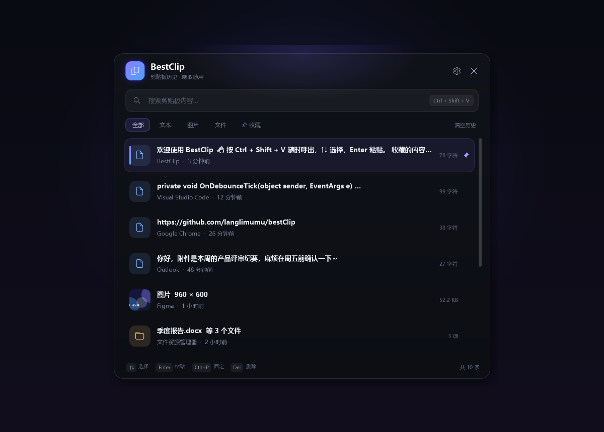
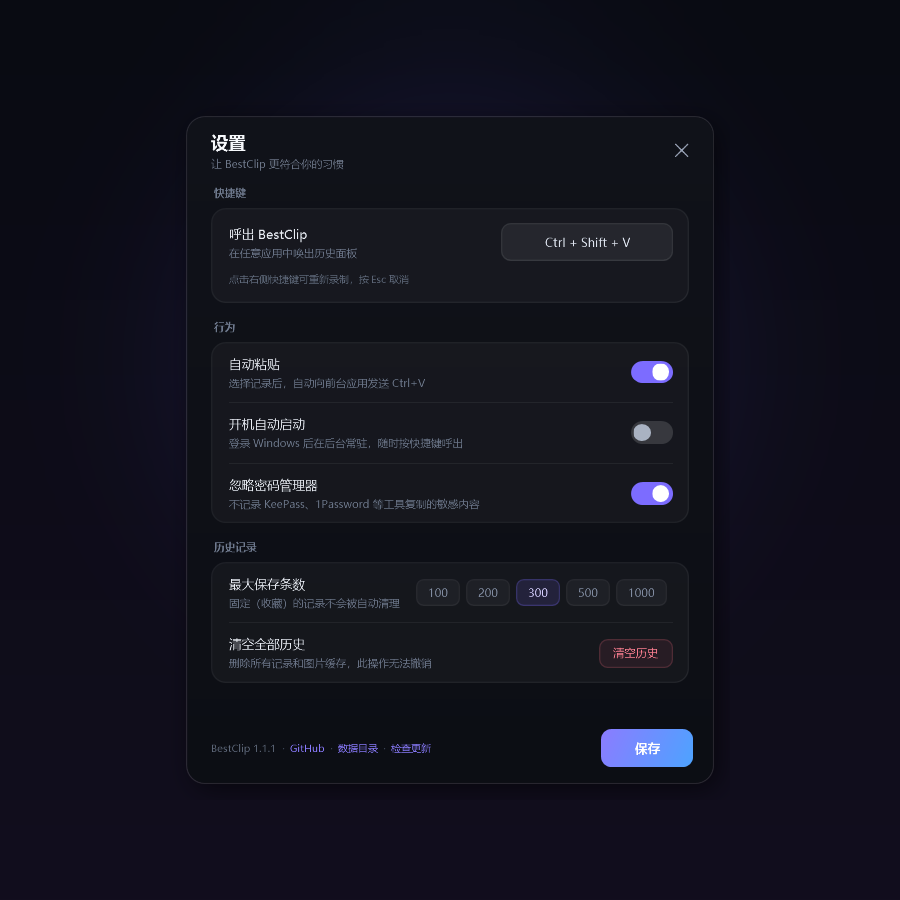

# BestClip

> 轻巧、好看的 Windows 剪贴板历史工具。按 `Ctrl + Shift + V` 随时呼出，文本、图片、文件都能找回来。



BestClip 是一个单文件、免安装的 Windows 剪贴板管理器。它常驻托盘，在后台安静地记录你复制过的内容；需要时用一个快捷键呼出，搜索、选择、回车，内容就回到当前窗口。

## 1.1.1 更新

- **修复受限电脑上的启动失败**：当 `%APPDATA%\BestClip` 不可写时，自动回退到程序目录下的 `BestClip-data`，再回退到 `%TEMP%\BestClip`，不再弹出“访问被拒绝”。
- **便携版更真正便携**：把程序放在 U 盘或受限目录也能直接运行，数据跟随程序目录。

## 1.1 更新

- **更聪明的一行预览**：短消息完整显示；长代码、多行文本只取首行，列表不再挤成一团。
- **更稳的历史容量**：除最大条数外，再增加 128 MB 总容量上限；自动清理未收藏的旧记录，并清理不再被引用的图片缓存。
- **更顺手的设置**：设置窗口打开即可按 `Esc` 关闭；新增“数据目录”和“检查更新”入口。
- **更明确的反馈**：全局快捷键被占用时托盘气泡提示，主界面徽标显示“快捷键未生效”；首次关闭窗口会提示程序仍在后台。
- **更好的高 DPI / 多屏表现**：窗口高度按屏幕工作区自适应，设置窗口始终居中在主窗口所在屏幕。

## 功能

- **三种剪贴板类型**：文本、图片、文件（可多选）都会记录，并显示来源应用与时间。
- **快速搜索**：呼出后直接输入关键词，按类型（文本 / 图片 / 文件 / 收藏）筛选。
- **一键回填**：选中记录按 `Enter`，BestClip 会把内容写回剪贴板，并自动向前台应用发送 `Ctrl + V`。
- **收藏与置顶**：`Ctrl + P` 固定常用内容，固定项不会被自动清理。
- **删除与清空**：`Del` 删除单条；清空全部需要连续点击两次确认，避免误操作。
- **全局快捷键**：默认 `Ctrl + Shift + V`，可在设置中重新录制。
- **托盘常驻**：关闭窗口只是隐藏；托盘菜单可暂停记录、清空历史、打开设置、开机自启或退出。
- **开机自启**：写入当前用户的启动项，不需要管理员权限。
- **隐私优先**：所有数据只保存在本机（默认 `%APPDATA%\BestClip`，不可写时自动改用程序目录下的 `BestClip-data`），没有任何网络请求；可忽略 KeePass、1Password、Bitwarden 等密码管理器复制的内容。
- **高 DPI 友好**：适配 125% / 150% 缩放和多显示器，窗口会出现在鼠标附近并完整落在屏幕内。
- **免安装**：一个 exe + 一个 config，解压即用；Windows 10/11 自带 .NET Framework 4.8，无需额外安装运行时。

## 截图



深色界面、统一圆角与紫色强调色；所有设置一目了然。

## 下载与安装

1. 打开 [Releases](https://github.com/langlimumu/bestClip/releases/latest)，下载 `BestClip-portable.zip`。
2. 解压到任意目录，例如 `D:\Tools\BestClip`。
3. 双击 `BestClip.exe` 即可运行，无需安装。
4. 首次运行如果 Windows SmartScreen 提示“Windows 已保护你的电脑”，点击 **更多信息 → 仍要运行**。这是因为个人项目没有购买代码签名证书，不代表程序有问题。

> 系统要求：Windows 10 2004+ / Windows 11，x64 或 ARM64（通过 .NET Framework 兼容层运行）。Windows 10/11 已内置 .NET Framework 4.8。

## 使用

| 操作 | 说明 |
| --- | --- |
| `Ctrl + Shift + V` | 呼出 / 隐藏 BestClip（可在设置中修改） |
| 直接输入 | 搜索剪贴板内容 |
| `↑` / `↓` | 选择记录 |
| `Home` / `End` | 跳到第一条 / 最后一条 |
| `Enter` | 粘贴到刚才的应用 |
| `Ctrl + P` | 固定 / 取消固定 |
| `Del` | 删除选中记录 |
| `Esc` | 依次关闭右键菜单、清空搜索、隐藏窗口 |
| 右键记录 | 粘贴 / 固定 / 删除 |
| 点击托盘图标 | 打开主窗口；右键打开菜单 |

关闭主窗口不会退出程序，BestClip 会继续在托盘记录；第一次关闭时会弹一次气泡提醒。要彻底退出，请使用托盘菜单中的 **退出**。

## 设置

- **呼出 BestClip**：点击快捷键框后按下新组合，至少包含 `Ctrl`、`Alt` 或 `Shift` 之一；`Esc` 取消录制。
- **自动粘贴**：关闭后只把内容写回剪贴板，不自动发送 `Ctrl + V`。
- **开机自动启动**：写入 `HKCU\Software\Microsoft\Windows\CurrentVersion\Run`，仅当前用户生效。
- **忽略密码管理器**：开启后，来自 KeePass、1Password、Bitwarden、LastPass、Dashlane、Enpass、RoboForm 的复制不会被记录。
- **最大保存条数**：100 / 200 / 300 / 500 / 1000，固定（收藏）的记录不计入自动清理。
- **数据目录**：打开 BestClip 实际使用的数据目录（默认 `%APPDATA%\BestClip`；不可写时自动回退到程序目录下的 `BestClip-data`，或 `BESTCLIP_DATA` 指定目录）。
- **检查更新**：打开 GitHub Releases 页面，查看是否有新版本。
- 底部同时显示当前版本号和项目链接；未保存的修改会在关闭时丢弃。

## 数据与隐私

数据目录：`%APPDATA%\BestClip\`（如果该位置不可写，会自动改用程序目录下的 `BestClip-data\`，仍不可写则使用 `%TEMP%\BestClip\`）

```
history.json    剪贴板历史（JSON）
settings.json   设置
images\         图片记录的 PNG 缓存
```

- 所有内容只在本机读写，BestClip 不包含任何联网代码（“检查更新”只是打开浏览器）。
- 历史同时受“最大条数”和 128 MB 总容量限制，超出后优先清理最旧的未收藏记录。
- 删除记录时会同步删除对应的图片文件；清空历史会清空整个图片缓存；启动时还会清理不再被引用的孤立图片。
- 卸载：退出 BestClip，删除程序目录和实际数据目录（默认 `%APPDATA%\BestClip`，或程序目录下的 `BestClip-data`）即可。
- 高级用法：设置环境变量 `BESTCLIP_DATA` 可以指定独立的数据目录，便于测试或多套配置。

## 从源码构建

环境：Windows 10/11 + .NET Framework 4.8（系统自带）。不需要 Visual Studio、.NET SDK 或 NuGet。

```bat
git clone git@github.com:langlimumu/bestClip.git
cd bestClip
build.cmd
```

产物在 `dist\BestClip.exe`。构建脚本直接调用系统自带的 `csc.exe`，将 XAML 作为资源嵌入，运行时通过 `XamlReader` 加载，因此不需要 XAML 编译工具链。

项目结构：

```
src\                 C# 源码与 XAML 界面
assets\              应用图标
docs\                README 截图
build.cmd            一键构建
app.manifest         DPI / 权限清单
app.config           .NET 4.8 运行时配置
```

## 常见问题

**快捷键没反应？**
可能被其他软件占用。打开设置，点击快捷键框重新录制一个组合即可；保存时会检测注册失败并恢复旧快捷键。

**自动粘贴没有生效？**
部分以管理员身份运行的程序（如任务管理器、部分 IDE）会拒绝来自普通权限程序的模拟按键。可以尝试以管理员身份运行 BestClip；少数应用会主动屏蔽合成的 `Ctrl + V`，此时可关闭“自动粘贴”，手动按 `Ctrl + V`。

**开机自启保存失败？**
公司电脑的安全策略可能禁止写入启动项。可以手动把 `BestClip.exe` 的快捷方式放进 `shell:startup` 目录，并加上 `--autostart` 参数。

**为什么记录里没有我刚复制的密码？**
如果开启了“忽略密码管理器”，来自密码管理器进程的内容会被跳过；这是有意设计。

## License

[MIT](LICENSE) © 2026 langlimumu
